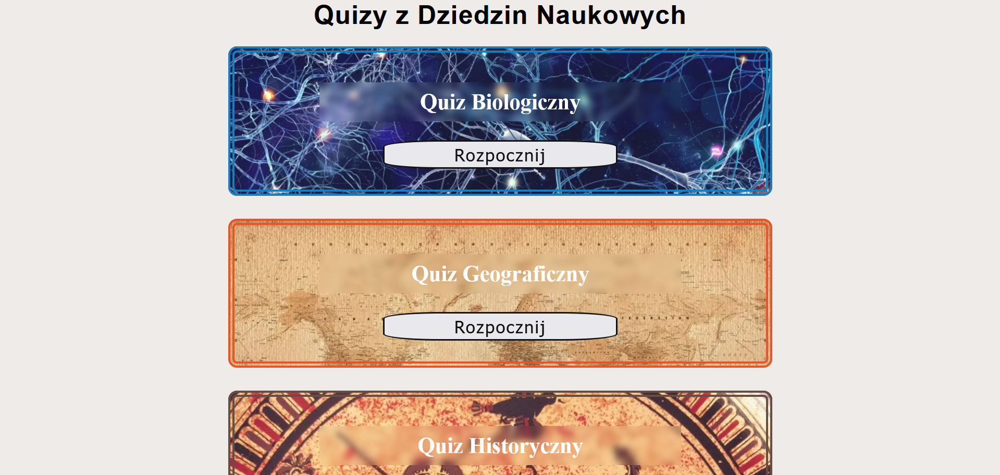
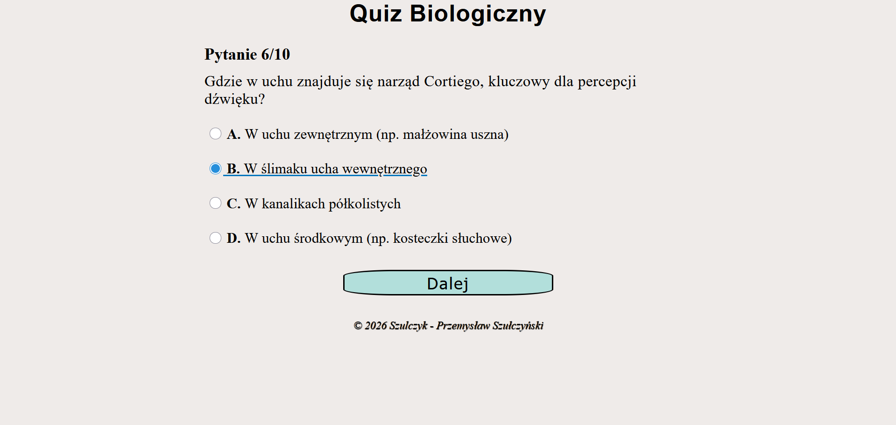
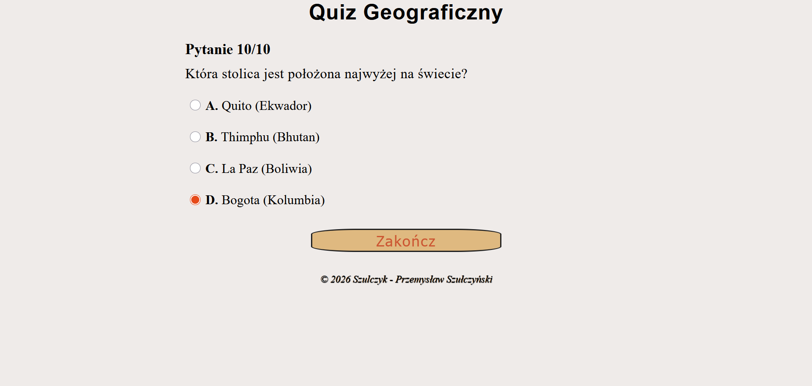
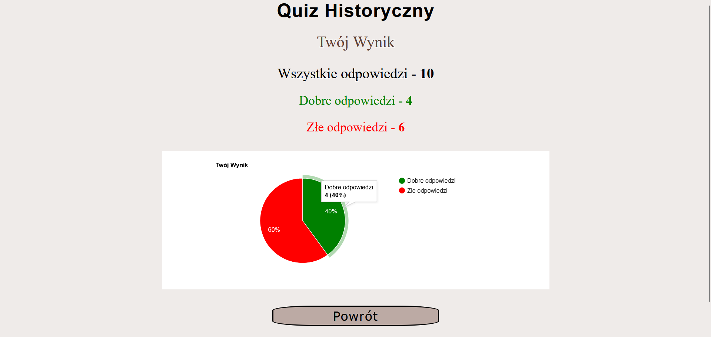

# ***[Projekt Quiz](https://szulczyk.pl/projekt-22/quiz)***

## 🖼️ ***Zrzuty ekranu***

 

## 📄 ***Opis projektu***
### ✅ *Projekt zakończony dnia 15.03.2026*
### *Projekt umożliwia sprawdzenie wiedzy z zakresu biologii, geografii lub historii. Aplikacja losuje dla użytkownika 10 pytań, z których każde wymaga jednorazowej, ostatecznej odpowiedzi. Podczas rozwiązywania testu nie można cofać się do wcześniej wygenerowanych pytań. Po przejściu wszystkich pytań aplikacja wyświetla podsumowanie z liczbą poprawnych oraz błędnych odpowiedzi, a końcowe statystyki są czytelnie prezentowane w postaci wykresu kołowego.*

 

## 🛠️ ***Stack projektu***
- ### *Frontend*
  - ### *HTML5*
  - ### *SASS*
  - ### *JavaScript*
  - ### *Google Charts*
- ### *Backend*
  - ### *PHP*
- ### *Bazy danych*
  - ### *MySQL*

 

## 📌 ***Podsumowanie projektu***
### 🎯 *Głównym celem projektu było zbudowanie aplikacji quizowej, która oferuje 360 pytań podzielonych na trzy unikalne wizualnie kategorie. Do jej stworzenia wykorzystałem PHP oraz po raz pierwszy zastosowałem SASS, a podsumowanie wyników wzbogaciłem o wykres kołowy.*
### 💡 *Czego się nauczyłem:*
- ### *Praktyka z SASS - nauczyłem się obsługi preprocesora SASS, pisząc znacznie bardziej uporządkowany i czytelny kod CSS.*
- ### *Wykres z Google Charts - opanowałem integrację biblioteki Google Charts, aby czytelnie zwizualizować końcowe wyniki gracza za pomocą wykresu.*
- ### *Baza danych i losowanie - stworzyłem dużą bazę danych dla 3 kategorii i ustawiłem kod tak, by bez problemu losował z niej pytania.*
- ### *Dedykowany design - przećwiczyłem tworzenie dynamicznego designu poprzez przypisanie unikalnej palety barw do każdej kategorii quizu.*
- ### *Sesja, bezpieczeństwo oraz wygląd - po raz kolejny wykorzystałem zmienne sesyjne do zapisu stanu rozgrywki, co połączyłem z zabezpieczeniem kodu i zadbaniem o estetyczną prezentację całości aplikacji.*

 

## 📨 ***Kontakt***
- ### 📧 *E-mail -* przemo.ppk@gmail.com
- ### 💻 *Discord -* darkcoder97